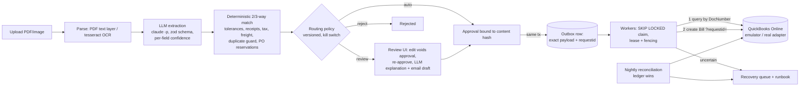

# invoice-posting-agent

**An accounts-payable service that posts vendor invoices to QuickBooks Online without duplicate Bills or lost
invoices: 0 lost and 0 duplicates in 257 non-residual fault-injection seeds (1 duplicate in 43 pre-declared
residual-risk seeds, caught by reconciliation), and 10/10 posted on the real QuickBooks sandbox with a worker
killed mid-post.**

[](https://github.com/TonyLee-99/invoice-posting-agent/actions/workflows/ci.yml)


| business problem | what I built | measured results |
|---|---|---|
| AP teams key invoices into QuickBooks by hand; the costly failures are on the **write**: a Bill entered twice is paid twice, a lost one becomes a late fee. | Upload → parse/OCR → LLM extraction (zod-validated, per-field confidence) → **deterministic** 3-way match → routing → review UI with approvals bound to a content hash → transactional outbox → worker posts with a stable `requestid` after querying first → nightly reconciliation → recovery queue. | Chaos (emulator, 300 seeds): **0** lost, **0** duplicates in the 257 non-residual seeds, **1** in the 43 residual-risk seeds; all defenses off: **85 of 100** seeds produce duplicates. Extraction F1 **0.941** (95% CI 0.889–0.981) vs **0.765** regex baseline on 40 public labelled invoices. Auto-approval **8/8** correct (n=8, Wilson 95% CI 0.68–1.00). **$0.0012** LLM cost per invoice. |

### What ran live (QuickBooks Online sandbox, 2026-11-11)
| run | result | source |
|---|---|---|
| Contract checks | repeat requestid → same Bill; same requestid + different body → original response; concurrent twin → **HTTP 425**, 1 Bill; DocNumber query saw the new Bill after **350 ms**; duplicate DocNumber with a new requestid is **accepted**; token refresh works (refresh token did not rotate) | `results/qbo_live_contract.json` |
| Demo: 10 invoices through the real pipeline, one worker process SIGKILLed after its remote write | **10/10** posted, **1** adopted after the kill, **0** duplicates, **0** missing, reconciliation 10/10, recovery queue empty | `results/qbo_live_demo.json` |

The first live runs found three gaps the emulator had hidden — QBO filling `DueDate`, HTTP 425 for in-flight
requestids, cached requestid responses replayed to a fresh database. All three are fixed and now reproduced offline
([postmortem](docs/INCIDENTS.md)). Demo Bills were deleted from the sandbox afterwards.

**More:** [architecture](#architecture) · [run it](#run-it-offline-3-commands) · [results](#results) ·
[real vs simulated](#what-is-real-and-what-is-simulated) · [limitations](#limitations) · [project documents](docs/README.md)
(PRD, design, acceptance, eval, runbook, rollout, ADRs, incidents) · static demo: `docs/demo/`

## Architecture



The LLM never decides: matching, routing, approval and posting are plain code (ADR-0002). The write path combines
four defenses because no single one is enough (`docs/DESIGN.md` §5): a stable `requestid` (QBO returns the original
response for a repeat), **query-before-every-write** by DocNumber with an integration marker in `PrivateNote`,
**claim-generation fencing** for stale workers, and a **lease guard** that refuses to send with too little lease left.

## Run it (offline, 3 commands)

```bash
make init                         # npm ci + Playwright browser; needs Node 24 and Postgres 16 on localhost
make check                        # lint, types, 105 unit/fault tests, 50-seed chaos, replay eval diff — zero LLM calls
make demo & npm run dev -w @ipa/review   # API + worker + QBO emulator on :4000, review UI on :3000
```

`make reproduce` runs the live path (parsing/OCR + `claude -p --model claude-haiku-5-5`, at most 4 concurrent) and
re-records `results/`. `make chaos-full` re-runs the 300-seed chaos + ablations. Sizes are knobs:
`npx tsx eval/run.ts --n 232` (the whole test split), `make chaos SEEDS=500`.

### Run against the real QuickBooks sandbox
After the one-time setup in `docs/RUNBOOK.md` (Intuit app with
redirect URI `http://localhost:8777/callback`, keys in the keychain as `qbo-client-id` / `qbo-client-secret`):

```bash
make qbo-auth        # OAuth connect -> private/qbo_tokens.json (0600, gitignored)
make qbo-contract    # sandbox contract checks for the documented-vs-unknown QBO behaviors -> results/qbo_live_contract.json
make qbo-live-demo   # 10 Bills through the real pipeline + worker SIGKILL + reconciliation -> results/qbo_live_demo.json
```

Without credentials each target prints `SKIP` and exits 0; the same scripts are rehearsed against the emulator in CI.

## Results

| measure | result | baseline / control | source |
|---|---|---|---|
| Chaos, 300 seeds on the emulator: 4,180 invoices, 917 worker crashes, 75 emulator restarts, stalls, edits, and 2,799 injected remote events — **1,615 failures** (697 5xx before commit, 683 committed-then-response-lost: 5xx after commit / connection reset / hang, 34 hangs without commit, 139 throttling, 62 token expiries) plus **1,184 latency-only** | duplicates: **0** in 257 non-residual seeds, **1** in 43 residual-risk seeds (detected by reconciliation, voided by the runbook); lost: **0**; ledger≠local after reconciliation: **0** | all defenses off: 353 duplicates, 85/100 seeds | `results/chaos.json` |
| Deterministic fault scenarios A1–A18 incl. real SIGKILL of a worker process | all pass | requestid or query-first ablated alone → duplicate; fencing and lease guard are redundant layers (duplicate only with both off) | `services/posting/test/*.test.ts` |
| Field extraction micro F1 (40 docs, test split) | **0.941** (0.889–0.981) | regex baseline **0.765** (0.712–0.809) | `results/extraction.json` |
| IPP official scorer, key fields | **184 / 208** (88.5%) | — | `results/ipp_official_scores.json` |
| Matcher self-consistency check (label fields vs **Simulated** POs/receipts/vendors generated from the same labels — not independent evidence) | **1.000** (40/40) on the eval set; **0.997** (296/297) on all labelled docs; 16/16 added FX cases | 0.975 (39/40) before the dual-currency rule | `results/matching.json` |
| Auto-approval at threshold 0.9 | **20%** auto-approved; **8/8** correct (n=8, Wilson 95% CI 0.68–1.00) | — | `results/routing.json` |
| Drafted vendor emails with only grounded numbers | **10 / 10** (first run 4/10, fixed: INC-6) | — | `results/drafts.json` |
| LLM cost / latency per invoice | **$0.0012**, p50 9.5 s | — | `results/cost.json` |

Error analysis, calibration table and provenance: `docs/EVAL.md`. Real bugs found by the suite: `docs/INCIDENTS.md`.

## What is real and what is simulated

| real | **Simulated** / not live |
|---|---|
| Invoice documents and labels: two public benchmarks (IPP CC BY 4.0, 181 docs; Katana MIT, 116 docs) — generated documents, labels by their publishers | POs, goods receipts, vendor master, discrepancies (generated from labels, `eval/procure.ts`) |
| Every LLM call (cached in `cache/replay/`), every fault-injection result, the reconciliation runs | QuickBooks: chaos and fault suites run against the local **emulator**; the real adapter ran against a QBO **sandbox** company (contract checks + a 10-invoice demo), not a production company |
| The review UI and API running the full pipeline | Stakeholder discovery and ROI inputs (`docs/DISCOVERY.md`, `results/roi.json`) |

Emulator differences and every QBO assumption with its source: `docs/QBO_SEMANTICS.md`.

## Limitations
- 40-document extraction sample; CIs are wide. OCR on phone photos and handwriting causes 17 of 26 field errors.
- The matcher numbers are a self-consistency check: POs, receipts and vendors are generated from the same invoice labels
  the matcher reads (`eval/procure.ts`), and the expected outcomes follow rules I wrote. They show the implementation
  does what the policy says, not that the policy is right for a real AP team.
- Auto-approval precision rests on 8 approvals (Wilson lower bound 0.68); it is not evidence of 98% precision.
- One residual duplicate path is not prevented, only detected: requestid memory lost **and** the first write invisible
  to the query. It happened once in 43 residual-eligible chaos seeds (seed 30) and reconciliation caught it.
- Chaos and fault numbers come from the emulator; the live sandbox runs are one contract check and one 10-invoice demo.
- Requestid retention is unpublished by Intuit and not measured; concurrency semantics were observed live (425).
- Confidence is a heuristic score (monotone with accuracy in the table), not a fitted calibrator.
- Credit notes, payments and tax codes are out of scope.

## From demo to production
1. Production Intuit keys (sandbox contract checks are done: `results/qbo_live_contract.json`); then shadow mode (ROLLOUT §0).
2. Secrets in a manager; per-realm token rows; alert on refresh failure (auth circuit breaker already pauses workers).
3. Partition the outbox by realm at ~100x volume; reconciliation by CDC instead of full inventory scans.
4. A vision-model pass for low-OCR-confidence pages; a fitted calibrator once there are a few hundred labelled reviews.
5. Tolerances and caps editable by the AP manager with policy versions (already stamped on every decision).

## Repo map
`packages/domain` schemas & money · `packages/llm` claude-cli / anthropic / replay client · `packages/extract` parse,
OCR, LLM + baseline extraction · `packages/matching` matcher + routing · `packages/qbo` client + emulator ·
`services/posting` state machine, outbox worker, reconciliation, recovery, API, chaos · `apps/review` Next.js UI ·
`eval/` datasets, evals, chaos runner · `docs/` PRD, DESIGN, ACCEPTANCE, EVAL, RUNBOOK, ROLLOUT, ADRs, INCIDENTS.

Data attribution: Invoice Extraction Benchmark v1 © 2026 InvoiceParser Pro, CC BY 4.0
(github.com/DrewKraken/invoice-extraction-benchmark); Katana ML Sparrow invoices (MIT), derived from Kozłowski &
Weichbroth (2021), "Samples of electronic invoices", Mendeley Data, doi:10.17632/tnj49gpmtz.2. Sample documents
appear in `docs/demo/` under those terms.
