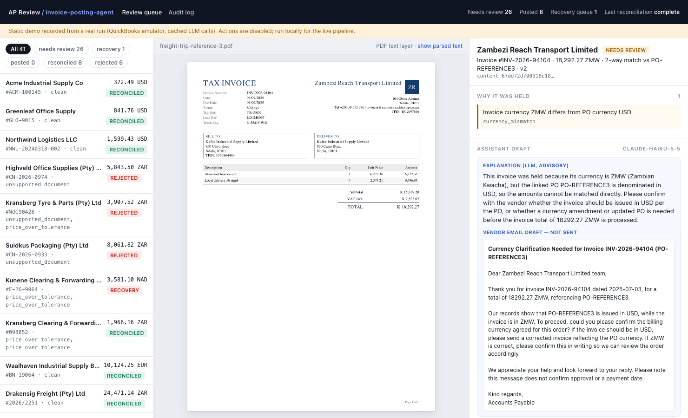
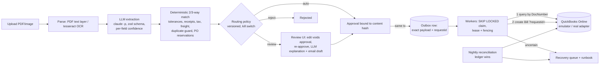

# invoice-posting-agent

**Posts vendor invoices to QuickBooks Online without duplicate Bills: 0 duplicates and 0 lost invoices across 300 randomized fault-injection seeds (4,180 invoices, 2,306 injected remote faults, 942 worker crashes), with LLM field extraction at 0.941 F1 vs 0.761 for a regex baseline.**

[](https://github.com/TonyLee-99/invoice-posting-agent/actions/workflows/ci.yml)




| business problem | what I built | measured results |
|---|---|---|
| AP teams key invoices into QuickBooks by hand; the costly failures are on the **write**: a Bill entered twice is paid twice, a lost one becomes a late fee. | A TypeScript service: upload → parse/OCR → LLM extraction (zod-validated, per-field confidence) → **deterministic** 3-way match → routing → review UI with approvals bound to a content hash → transactional outbox → worker posts to QBO with a stable `requestid` after querying first → nightly reconciliation → recovery queue. | **0** duplicate Bills / **0** lost invoices over **300** chaos seeds; with all defenses off **84 of 100** seeds produce duplicates. Extraction F1 **0.941** (95% CI 0.889–0.981) vs **0.761** baseline on 40 public labelled invoices. Auto-approval precision **8/8** at a 20% auto-approve rate. **$0.0012** LLM cost per invoice. |

Live demo (static, recorded from a real run): `docs/demo/` → GitHub Pages `/invoice-posting-agent/demo/`.

## Architecture



The LLM never decides: matching, routing, approval and posting are plain code (ADR-0002). The write path combines
four defenses because no single one is enough (`docs/DESIGN.md` §5): a stable `requestid` (QBO returns the original
response for a repeat), **query-before-every-write** by DocNumber with an integration marker in `PrivateNote`,
**claim-generation fencing** for stale workers, and a **lease guard** that refuses to send with too little lease left.

## Run it (offline, 3 commands)

```bash
make init                         # npm ci + Playwright browser; needs Node 24 and Postgres 16 on localhost
make check                        # lint, types, 75 unit/fault tests, 50-seed chaos, replay eval diff — zero LLM calls
make demo & npm run dev -w @ipa/review   # API + worker + QBO emulator on :4000, review UI on :3000
```

`make reproduce` runs the live path (parsing/OCR + `claude -p --model claude-haiku-5-5`, at most 4 concurrent) and
re-records `results/`. `make chaos-full` re-runs the 300-seed chaos + ablations. Sizes are knobs:
`npx tsx eval/run.ts --n 297` (all labelled documents), `make chaos SEEDS=500`.

## Results

| measure | result | baseline / control | source |
|---|---|---|---|
| Duplicate Bills, 300 chaos seeds (crashes, stalls, 5xx before/after commit, resets, hangs, 429, token expiry, emulator restarts, edits) | **0** | all defenses off: 353 duplicates, 84/100 seeds | `results/chaos.json` |
| Lost invoices / ledger≠local after reconciliation | **0 / 0** | — | same |
| Deterministic fault scenarios A1–A18 incl. real SIGKILL of a worker process | all pass | each defense ablated alone fails its schedule | `services/posting/test/*.test.ts` |
| Field extraction micro F1 (40 docs, test split) | **0.941** (0.889–0.981) | regex baseline **0.761** (0.710–0.805) | `results/extraction.json` |
| IPP official scorer, key fields | **184 / 208** (88.5%) | — | `results/ipp_official_scores.json` |
| Matcher vs labelled expected outcome (label fields) | **0.975** (39/40) | — | `results/routing.json` |
| Auto-approval at threshold 0.9 | **20%** auto, precision **8/8** (Wilson 0.68–1.00) | — | same |
| Drafted vendor emails with only grounded numbers | **10 / 10** (first run 4/10, fixed: INC-6) | — | `results/drafts.json` |
| LLM cost / latency per invoice | **$0.0012**, p50 9.5 s | — | `results/cost.json` |

Error analysis, calibration table and provenance: `docs/EVAL.md`. Real bugs found by the suite: `docs/INCIDENTS.md`.

## What is real and what is simulated

| real | **Simulated** / not live |
|---|---|
| Invoice documents and labels: two public benchmarks (IPP CC BY 4.0, 181 docs; Katana MIT, 116 docs) — generated documents, labels by their publishers | POs, goods receipts, vendor master, discrepancies (generated from labels, `eval/procure.ts`) |
| Every LLM call (cached in `cache/replay/`), every fault-injection result, the reconciliation runs | QuickBooks: all posting is against the local **emulator**; the real adapter (OAuth, refresh rotation, requestid, minorversion 75) is written per Intuit docs but **not run live** |
| The review UI and API running the full pipeline | Stakeholder discovery and ROI inputs (`docs/DISCOVERY.md`, `results/roi.json`) |

Emulator differences and every QBO assumption with its source: `docs/QBO_SEMANTICS.md`.

## Limitations
- 40-document extraction sample; CIs are wide. OCR on phone photos and handwriting causes 17 of 26 field errors.
- One residual duplicate path is not prevented, only detected: requestid memory lost **and** the first write invisible
  to the query (43 eligible chaos seeds, 0 occurrences — not a proof).
- Requestid retention and concurrency semantics are unpublished by Intuit; sandbox contract tests are pending.
- Confidence is a heuristic score (monotone with accuracy in the table), not a fitted calibrator.
- Credit notes, payments, multi-currency FX and tax codes are out of scope.

## From demo to production
1. Intuit app + sandbox contract tests for the unknown rows in `docs/QBO_SEMANTICS.md`; then shadow mode (ROLLOUT §0).
2. Secrets in a manager; per-realm token rows; alert on refresh failure (auth circuit breaker already pauses workers).
3. Partition the outbox by realm at ~100x volume; reconciliation by CDC instead of full inventory scans.
4. A vision-model pass for low-OCR-confidence pages; a fitted calibrator once there are a few hundred labelled reviews.
5. Tolerances and caps editable by the AP manager with policy versions (already stamped on every decision).

## Repo map
`packages/domain` schemas & money · `packages/llm` claude-cli / anthropic / replay client · `packages/extract` parse,
OCR, LLM + baseline extraction · `packages/matching` matcher + routing · `packages/qbo` client + emulator ·
`services/posting` state machine, outbox worker, reconciliation, recovery, API, chaos · `apps/review` Next.js UI ·
`eval/` datasets, evals, chaos runner · `docs/` PRD, DESIGN, ACCEPTANCE, EVAL, RUNBOOK, ROLLOUT, ADRs, INCIDENTS.

Data attribution: Invoice Extraction Benchmark v1 © 2026 InvoiceParser Pro, CC BY 4.0
(github.com/DrewKraken/invoice-extraction-benchmark); Katana ML Sparrow invoices (MIT), derived from Kozłowski &
Weichbroth (2021), "Samples of electronic invoices", Mendeley Data, doi:10.17632/tnj49gpmtz.2. Sample documents
appear in `docs/demo/` under those terms.
